# Net_Pacing

Based on the continuous BBR Startup derivation shared by Neal Cardwell, I calculated a slow-start pacing gain of 2 ln 2 (≈ 1.386) for cwnd-based pacing. To verify whether this gain can preserve exponential window doubling while spreading packets across the entire RTT in discrete packet scheduling, and to compare performance across different gains, this project sweeps pacing gains from 1.0 to 8.0 under a 100 ms RTT and zero loss.

The experiments are conducted across two environments:
- **SSCP**: A TCP-like protocol I wrote, running in an in-process discrete-event simulation network as a clean discrete baseline without OS scheduling jitter or hardware offload interference.
- **Linux TCP**: Real kernel Reno + FQ pacing in network namespaces, using four progressive configurations to systematically isolate the effects of socket buffers, NIC offloads (TSO/GSO/GRO), and Delayed ACK.

## Analytical Derivation Formula

According to continuous model derivation, the packet transmission dispersion span within a round satisfies:

Transmission Span = (2 ln 2 / g) * RTT

- At gain g = 2 ln 2 ≈ 1.386 (configured as 139 in Linux):
  Transmission Span = (2 ln 2 / 2 ln 2) * RTT = 1.0 * RTT = 100 ms
  Packet transmissions spread across the entire RTT, eliminating periodic idle gaps.
- At gain g = 2.0 (Linux default 200):
  Transmission Span = (2 ln 2 / 2.0) * RTT = ln 2 * RTT ≈ 69.3 ms
  Packets are sent within ~69.3 ms, leaving a ~30.7 ms idle gap before the next round of ACKs arrives.

## Visual Comparison: 2 ln 2 vs 2.0

Time-sequence graphs comparing the theoretical threshold 2 ln 2 and standard gain 2.0 across the discrete virtual network SSCP, Linux **quickack** (disabled offloads and delayed ACK for micro discrete packet timing), and Linux **buf64m** (retained TSO hardware offload for macro exponential growth). Full 7-gain figures are listed in the directories below.

### SSCP (Virtual Network)

Environment: in-process discrete-event simulation, 1 µs tick clock, dual 50 ms FIFO queue delays (100 ms total RTT, 0 loss), 1 GiB memory transfer. Event logs are exported to xplot format (.xpl).

| Gain 2 ln 2 (1.386) | Gain 2.0 |
| :---: | :---: |
| 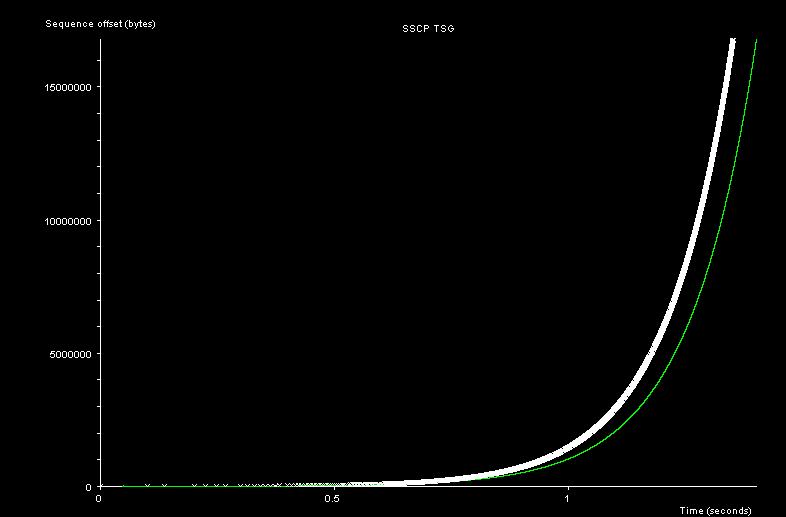 | 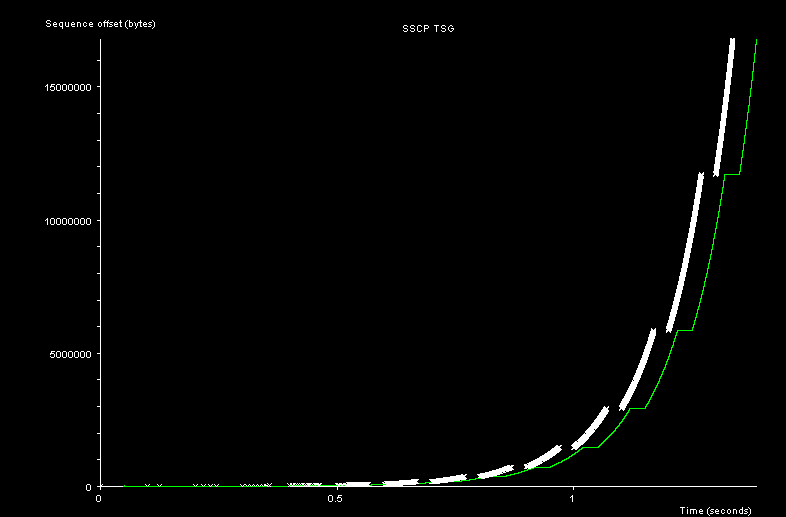 |
| 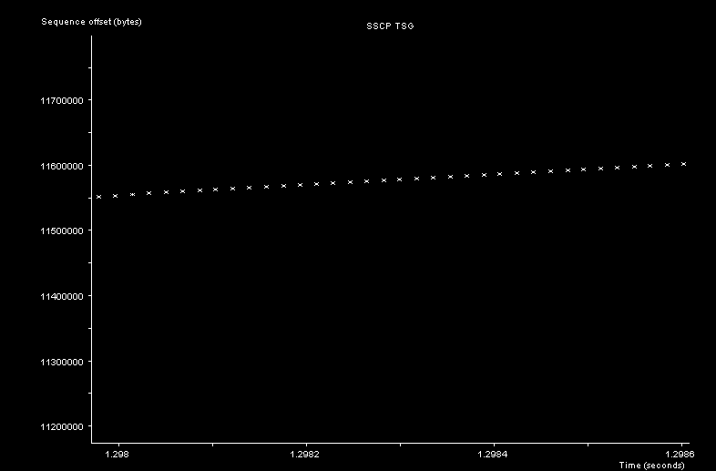 | 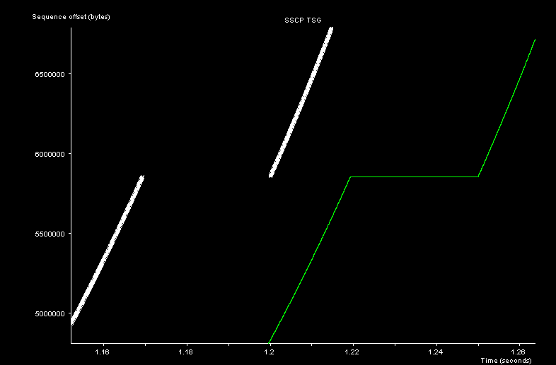 |

- **g138_6 (2 ln 2)**: Transmissions spread continuously across the entire 100 ms RTT with no trailing idle pause.
- **g200 (2.0)**: Packets are transmitted within ~69 ms, leaving a ~30 ms idle plateau before the next round of ACKs.

### Linux TCP (Progressive Configurations)

Environment: Three network namespaces connected via veth pairs; the intermediate node injects dual 50 ms delays (100 ms total RTT, 0 loss) for a 128 MB transfer. Captured on the intermediate node and exported to xplot format via tcptrace.

The four configurations form a strict, cumulative layer-by-layer progression:
1. **default**: Standard Linux baseline environment.
2. **buf64m**: **Built on default**, uncaps socket buffers to 64 MB.
3. **offload_off**: **Built on buf64m**, disables NIC offloads (TSO, GSO, GRO) to restore single-packet granularity.
4. **quickack**: **Built on offload_off**, enables route quickack 1 to restore an immediate 1:1 ACK clock.

#### 1. quickack Configuration (Microscopic Single-Packet Timing)

Disables hardware offloads and enables immediate ACKs to isolate discrete packet scheduling:

| Gain 139 (2 ln 2) | Gain 200 (2.0) |
| :---: | :---: |
| 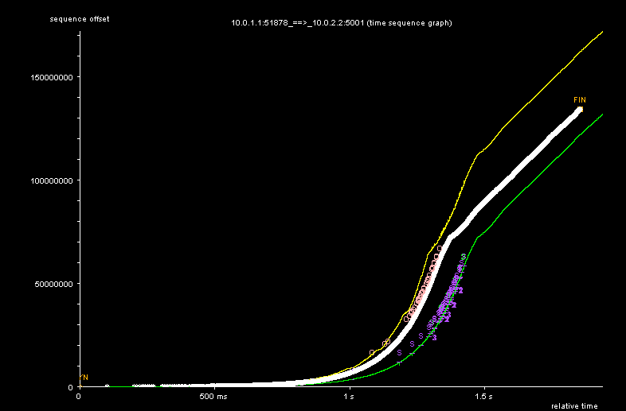 | 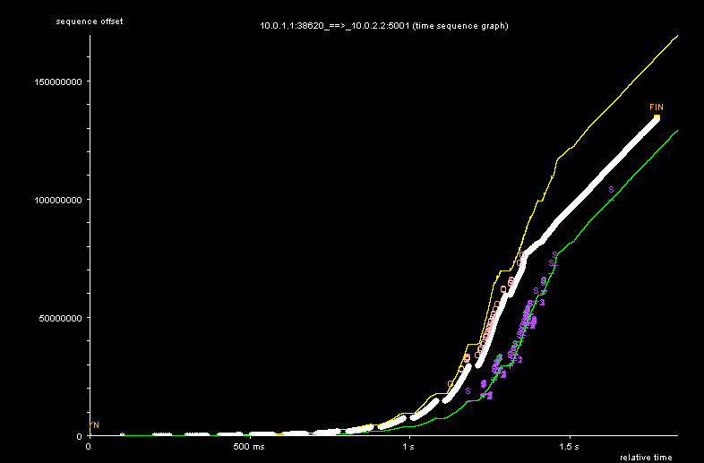 |
| 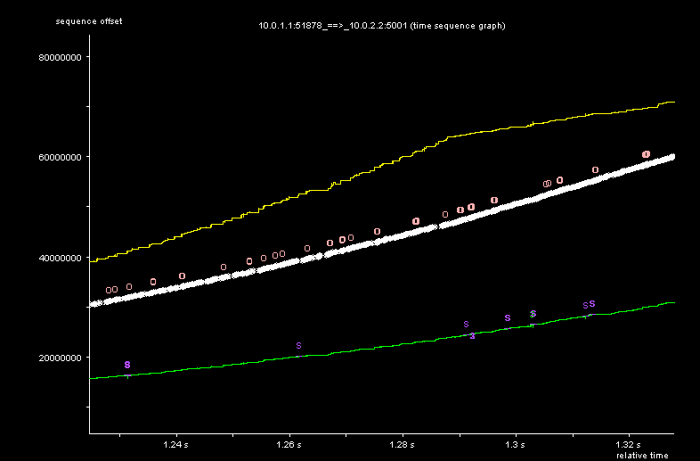 | 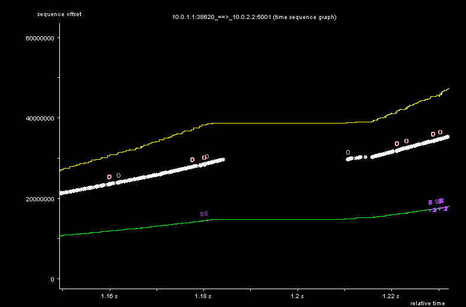 |

- **Slow-start zoom view**: g139 spreads packet transmissions across the entire RTT; g200 finishes within ~70 ms, leaving a ~30 ms idle plateau.
- **Full TSG straight line**: Without hardware offloads, late-stage packet processing hits CPU/softirq limits, flattening exponential growth into a constant-rate straight line.

#### 2. buf64m Configuration (Macroscopic Exponential Growth)

Retains TSO offload to observe the unbottlenecked window doubling curve:

| Gain 139 (2 ln 2) | Gain 200 (2.0) |
| :---: | :---: |
| 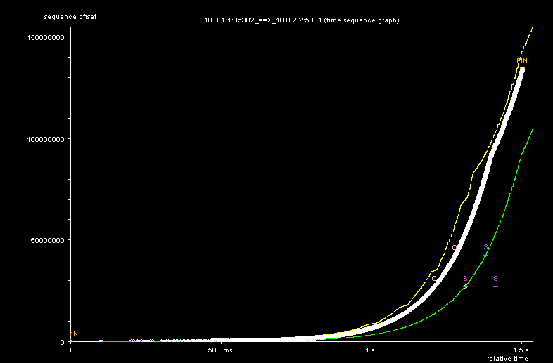 | 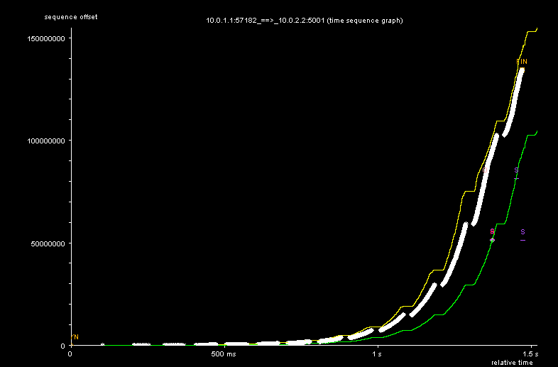 |
| 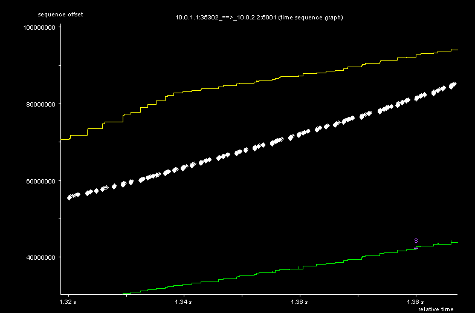 | 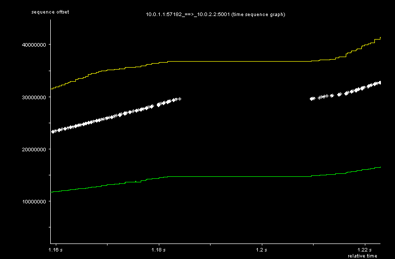 |

- **Full TSG**: Retaining TSO aggregation minimizes packet sample counts and softirq overhead, making the slow-start doubling phase much closer to theoretical exponential growth, though it also slightly trends toward a straight line at the very end as throughput approaches its limit.

## Repository Structure & Asset Index

This repository contains all experimental figures, raw time-sequence traces (.xpl), packet captures (.pcap), and reproduction documentation:

```
├── figures/              # Figures (full TSG a.png and slow-start zoom a_zin.png)
│   ├── sscp/             # SSCP first 16 MB across 7 gains (g100, g120, g138_6, g150, g200, g400, g800)
│   └── linux/            # Linux progressive configuration figures
│       ├── default/      # Baseline configuration (g139, g200)
│       ├── buf64m/       # 64 MB socket buffer configuration (all 7 gains)
│       ├── offload_off/  # Disabled offloads configuration (g139, g200)
│       └── quickack/     # Immediate ACK configuration (all 7 gains)
├── xpl/                  # Traces and packet captures directory
│   ├── jPlot.jar         # Bundled cross-platform interactive trace viewer
│   ├── sscp/             # SSCP first 16 MB exported .xpl traces
│   └── linux/
│       ├── buf64m/       # 128 MB full .xpl traces, raw .pcap captures, and tcptrace summaries
│       └── quickack/     # 128 MB full .xpl traces (g139, g200)
└── docs/                 # Detailed implementation and reproduction guides
    ├── sscp.md           # SSCP pacing implementation, virtual network, and 25-gain sweep
    ├── linux.md          # Linux namespace topology, 4 progressive configurations, and sweep scripts
    └── 中文/             # Chinese documentation
```

### Figures Directory
- [figures/sscp/](figures/sscp/): SSCP first 16 MB across 7 gains: g100, g120, g138_6, g150, g200, g400, g800.
- [figures/linux/default/](figures/linux/default/): Linux default config for g139 and g200.
- [figures/linux/buf64m/](figures/linux/buf64m/): Linux buf64m config across all 7 gains.
- [figures/linux/offload_off/](figures/linux/offload_off/): Linux offload_off config for g139 and g200.
- [figures/linux/quickack/](figures/linux/quickack/): Linux quickack config across all 7 gains.

### Traces Directory
- [xpl/sscp/](xpl/sscp/): SSCP first 16 MB sliced traces (.xpl) across 7 gains.
- [xpl/linux/buf64m/](xpl/linux/buf64m/): 128 MB full traces (.xpl) and pcap captures (.pcap) across all 7 gains.
- [xpl/linux/quickack/](xpl/linux/quickack/): 128 MB full traces (.xpl) for g139 and g200.
- [xpl/jPlot.jar](xpl/jPlot.jar): Cross-platform interactive trace viewer for .xpl files.

## Trace Visualization

Open and interactively explore the `.xpl` traces using the bundled `jPlot.jar` viewer (recommended by Sebastian Moeller on ICCRG, originally recommended to him by Stuart Cheshire: https://web.archive.org/web/20190628212118/http://www.tcptrace.org/software/jPlot/):

```sh
# SSCP traces (first 16 MB sliced)
java -jar xpl/jPlot.jar xpl/sscp/g138_6_16mb.xpl
java -jar xpl/jPlot.jar xpl/sscp/g200_16mb.xpl

# Linux quickack full traces (discrete single-packet)
java -jar xpl/jPlot.jar xpl/linux/quickack/g139-r1/a2b_tsg.xpl
java -jar xpl/jPlot.jar xpl/linux/quickack/g200-r1/a2b_tsg.xpl

# Linux buf64m full traces (macroscopic exponential)
java -jar xpl/jPlot.jar xpl/linux/buf64m/g139-r1/a2b_tsg.xpl
java -jar xpl/jPlot.jar xpl/linux/buf64m/g200-r1/a2b_tsg.xpl
```

## Documentation

- [docs/sscp.md](docs/sscp.md): SSCP slow-start pacing implementation (interval calculation and timer pacing line numbers), virtual network setup, 1.0–8.0 gain sweep, and reproduction instructions.
- [docs/linux.md](docs/linux.md): Linux network namespace reproduction guide, topology setup, step-by-step commands for 4 progressive configurations, and automated sweep script.
- [docs/中文/README.md](docs/中文/README.md): 中文完整文档。
