# Net_Pacing

基于 Neal Cardwell 分享的连续 BBR Startup 推导，我计算得到了基于 cwnd 的慢启动 Pacing 临界增益 2 ln 2（≈ 1.386）。为了验证该增益在离散数据包调度下，是否真如推导一样能够恰好把数据分散铺满整个 RTT 又不阻碍 cwnd 翻倍增长，并对比不同增益的具体表现，本项目在 100 ms RTT、0 丢包环境下，对 1.0 到 8.0 范围内的 Pacing 增益开展了系统性的扫参实验。

实验包含两个测试环境：
- **SSCP**：我自研的类 TCP 协议，运行在 1 µs 进程内离散事件模拟虚拟网络中，作为无系统调度抖动与硬件干扰的离散基准。
- **Linux TCP**：网络命名空间中的真实内核 Reno + FQ Pacing。通过四组递进配置逐步剥离套接字缓冲区、网卡硬件卸载（TSO/GSO/GRO）与延迟确认（Delayed ACK）的影响。

## 理论推导公式

按照连续模型推导，单轮数据包的发送分散时间（占 RTT 的比例）满足：

分散时间 = (2 ln 2 / g) * RTT

- 当增益 g = 2 ln 2 ≈ 1.386 时（Linux 中设置为 139）：
  分散时间 = (2 ln 2 / 2 ln 2) * RTT = 1.0 * RTT = 100 ms
  发包平铺满整个 RTT，消除周期性断流空隙。
- 当增益 g = 2.0 时（Linux 默认 200）：
  分散时间 = (2 ln 2 / 2.0) * RTT = ln 2 * RTT ≈ 69.3 ms
  数据包在约 69.3 ms 内集中发完，尾部留下约 30.7 ms 的断流静默期。

## 2 ln 2 与 2.0 对比图

对比理论临界值 2 ln 2 与标准增益 2.0 的时序图。涵盖离散虚拟网络 SSCP、Linux **quickack**（剥离硬件卸载与延迟确认，呈现微观单包时序）与 Linux **buf64m**（保留 TSO 硬件聚合，无单包中断瓶颈，呈现宏观指数增长）。全部 7 组增益的时序图见下方目录。

### SSCP（虚拟网络）

运行环境：进程内离散事件模拟，1 µs 时钟步长，双向各 50 ms FIFO 延迟（总 RTT 100 ms，0 丢包），1 GiB 内存传输。事件日志导出为 xplot 格式（.xpl）。

| 增益 2 ln 2 (1.386) | 增益 2.0 |
| :---: | :---: |
| 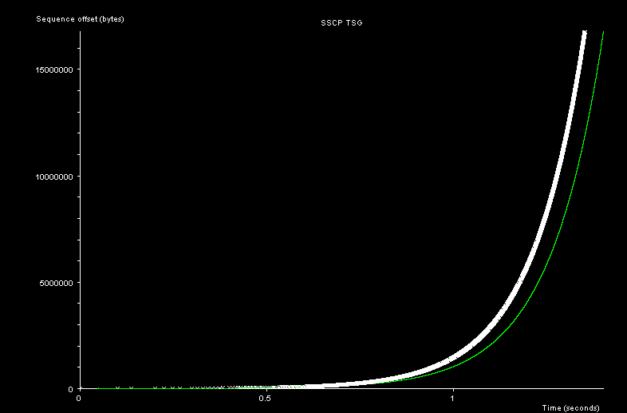 | 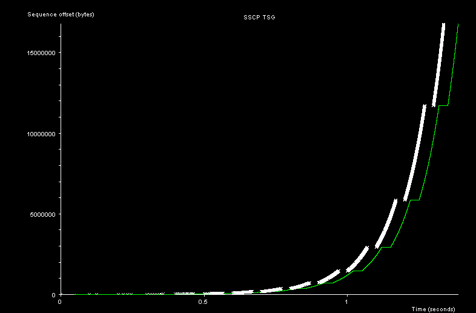 |
| 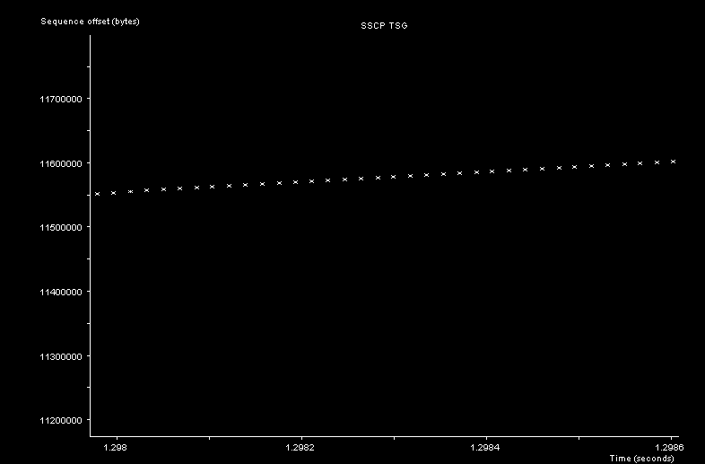 | 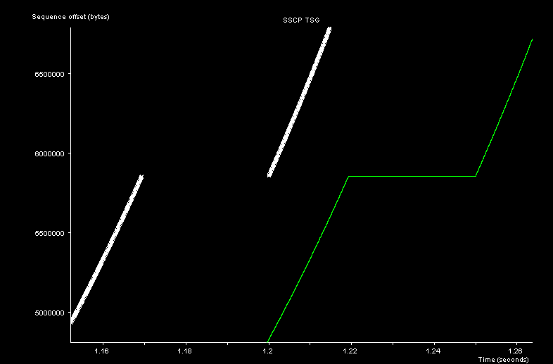 |

- **g138_6 (2 ln 2)**：发包平铺满整个 100 ms RTT，无尾部空隙。
- **g200 (2.0)**：数据在前约 69 ms 发完，尾部留下约 30 ms 断流空隙。

### Linux TCP（递进配置）

运行环境：三个网络命名空间通过 veth 串联，中间节点注入双向各 50 ms 延迟（总 RTT 100 ms，0 丢包），传输 128 MB。在中间节点抓包并经 tcptrace 导出为 xplot 格式。

四组配置层层递进、累加生效：
1. **default**：标准 Linux 默认环境。
2. **buf64m**：**在 default 基础上**解除套接字缓冲区至 64 MB。
3. **offload_off**：**在 buf64m 基础上**关闭硬件卸载（TSO/GSO/GRO），还原单包粒度。
4. **quickack**：**在 offload_off 基础上**启用路由 quickack 1，还原逐包即时 ACK 时钟。

#### 1. quickack 配置（微观单包时钟）

关闭硬件卸载并启用即时 ACK，还原纯净离散单包时序：

| 增益 139 (2 ln 2) | 增益 200 (2.0) |
| :---: | :---: |
| 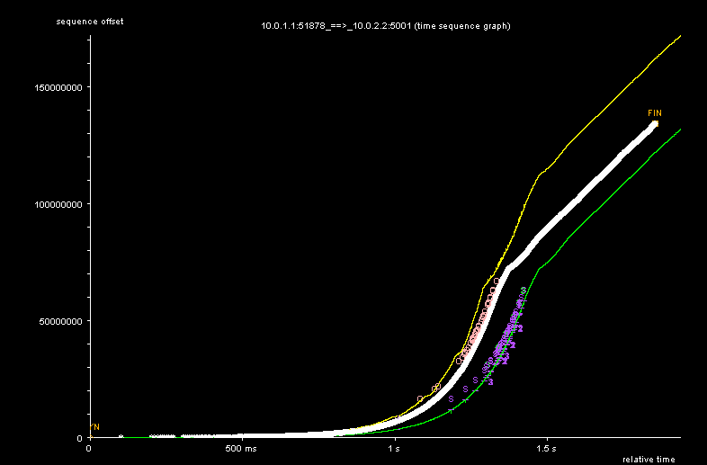 | 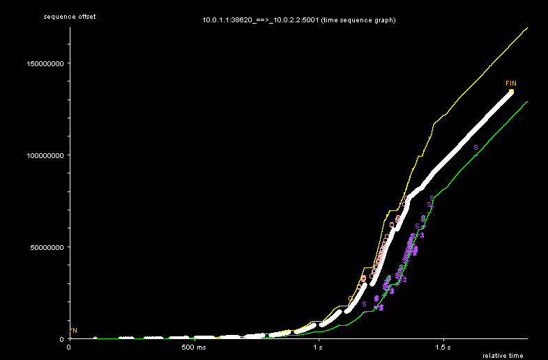 |
| 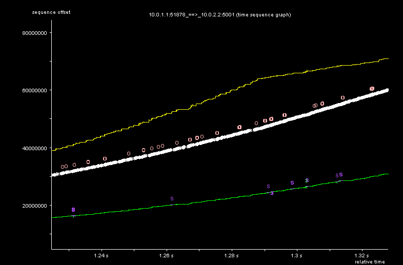 | 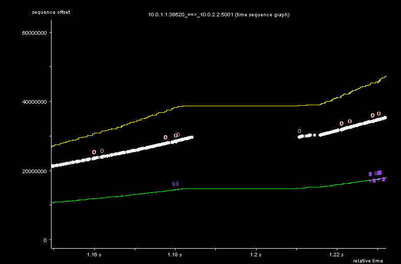 |

- **微观放大图**：g139 发包平铺满整个 RTT，消除周期性停等；g200 在前约 75 ms 集中发完，尾部留有约 25 ms 空隙。
- **全景直线现象**：关闭硬件卸载后，传输后期的高吞吐引发海量单包与即时 ACK 的 CPU/软中断瓶颈，发包速率受限于单包处理上限而退化为恒定速率的斜直线。

#### 2. buf64m 配置（宏观指数增长）

保留 TSO 硬件卸载，观察无 CPU 瓶颈时的窗口翻倍曲线：

| 增益 139 (2 ln 2) | 增益 200 (2.0) |
| :---: | :---: |
| 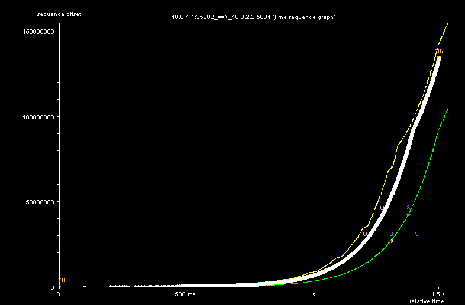 | 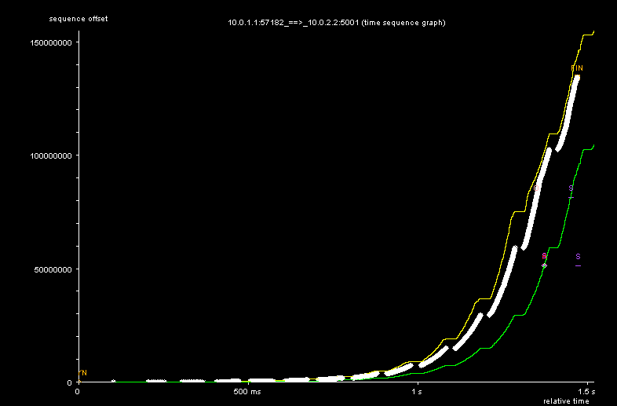 |
| 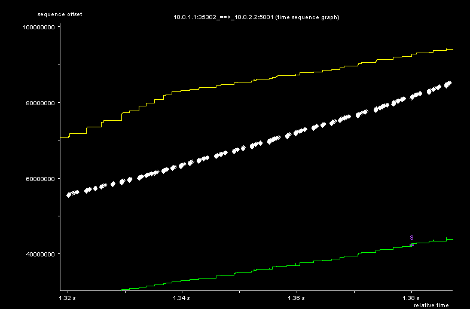 | 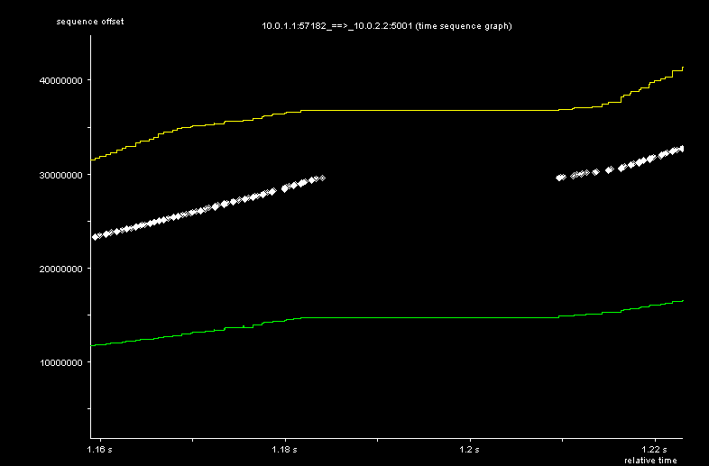 |

- **全景曲线**：保留 TSO 聚合使数据包采样极少并大幅降低软中断开销，其慢启动翻倍过程最接近理论指数增长；而在传输尾部速率接近极限时，曲线也出现小幅走直倾向。

## 仓库目录与数据索引

本仓库包含全部实验截图、原始时序轨迹（.xpl）、抓包文件（.pcap）以及复现文档：

```
├── figures/              # 运行截图目录（包含全部全景图 a.png 与慢启动局部放大图 a_zin.png）
│   ├── sscp/             # SSCP 前 16 MB 的 7 组增益截图（g100, g120, g138_6, g150, g200, g400, g800）
│   └── linux/            # Linux 四组递进配置截图
│       ├── default/      # 默认基准配置（g139, g200）
│       ├── buf64m/       # 64 MB 缓冲区配置（全 7 组增益）
│       ├── offload_off/  # 关闭硬件卸载配置（g139, g200）
│       └── quickack/     # 启用即时 ACK 配置（全 7 组增益）
├── xpl/                  # 轨迹文件与抓包目录
│   ├── jPlot.jar         # 内置时序图交互查看工具
│   ├── sscp/             # SSCP 前 16 MB 导出的 .xpl 轨迹
│   └── linux/
│       ├── buf64m/       # 128 MB 完整 .xpl 轨迹、原始 .pcap 抓包与 tcptrace 摘要
│       └── quickack/     # 128 MB 完整 .xpl 轨迹（g139, g200）
└── docs/                 # 详细源码与环境复现文档
    ├── sscp.md           # SSCP 定时器发包机制、虚拟网络与 25 组扫参
    ├── linux.md          # Linux 网络命名空间搭建、四组递进配置逐步命令与扫参脚本
    └── 中文/             # 对应中文完整文档
```

### 运行截图目录
- [figures/sscp/](../../figures/sscp/)：SSCP 前 16 MB 的 7 组增益截图（g100、g120、g138_6、g150、g200、g400、g800）。
- [figures/linux/default/](../../figures/linux/default/)：Linux default 配置下 g139 与 g200 的截图。
- [figures/linux/buf64m/](../../figures/linux/buf64m/)：Linux buf64m 配置下全部 7 组增益的截图。
- [figures/linux/offload_off/](../../figures/linux/offload_off/)：Linux offload_off 配置下 g139 与 g200 的截图。
- [figures/linux/quickack/](../../figures/linux/quickack/)：Linux quickack 配置下全部 7 组增益的截图。

### 轨迹文件目录
- [xpl/sscp/](../../xpl/sscp/)：SSCP 前 16 MB 的 7 组切片轨迹（.xpl）。
- [xpl/linux/buf64m/](../../xpl/linux/buf64m/)：buf64m 配置下全部 7 组增益的 128 MB 完整轨迹（.xpl）与抓包文件（.pcap）。
- [xpl/linux/quickack/](../../xpl/linux/quickack/)：quickack 配置下 g139 与 g200 的 128 MB 完整轨迹（.xpl）。
- [xpl/jPlot.jar](../../xpl/jPlot.jar)：跨平台 xplot 轨迹交互查看工具。

## 查看轨迹

使用内置的 jPlot 打开并交互查看 `.xpl` 轨迹（由 Sebastian Moeller 在 ICCRG 邮件中推荐，源自 Stuart Cheshire 推荐：https://web.archive.org/web/20190628212118/http://www.tcptrace.org/software/jPlot/）：

```sh
# SSCP 轨迹
java -jar xpl/jPlot.jar xpl/sscp/g138_6_16mb.xpl
java -jar xpl/jPlot.jar xpl/sscp/g200_16mb.xpl

# Linux quickack 轨迹（微观单包）
java -jar xpl/jPlot.jar xpl/linux/quickack/g139-r1/a2b_tsg.xpl
java -jar xpl/jPlot.jar xpl/linux/quickack/g200-r1/a2b_tsg.xpl

# Linux buf64m 轨迹（宏观指数）
java -jar xpl/jPlot.jar xpl/linux/buf64m/g139-r1/a2b_tsg.xpl
java -jar xpl/jPlot.jar xpl/linux/buf64m/g200-r1/a2b_tsg.xpl
```

## 文档索引

- [sscp.md](sscp.md)：SSCP 慢启动 Pacing 源码实现（单包间隔计算与定时器放行代码行号）、虚拟网络测试说明、详细扫参范围（1.0 到 8.0）与复现切片命令。
- [linux.md](linux.md)：Linux 网络命名空间环境复现指南，包含拓扑搭建、四组递进配置逐步执行命令与自动化扫参脚本。
- [../../README.md](../../README.md)：English documentation.
